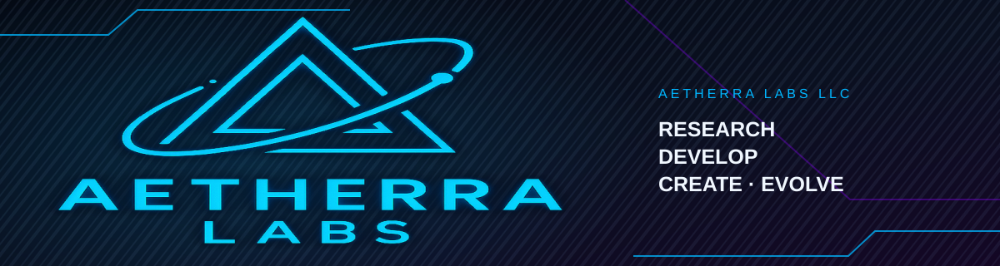

<div align="center">



# Timothy Holdorff

**Founder, Aetherra Labs LLC** · Independent developer & systems designer

*Building intelligent software, creative tools, and interactive worlds.*

[](https://aetherra.dev/)
[](https://github.com/Zyonic88?tab=repositories)

</div>

---

## // About me

I'm Timothy, the founder of **Aetherra Labs LLC**. I design and direct an evolving collection of projects in AI systems, software architecture, automation, narrative intelligence, and game development.

I enjoy exploring ambitious ideas, breaking them into well-defined systems, and finding out what actually works. I use AI-assisted workflows to accelerate development, but I care just as much about verification, maintainability, and honest reporting of what has — and hasn't — been built.

> **Build deliberately. Test relentlessly. Challenge assumptions. Automate the repetitive.**

## // The Aetherra ecosystem

| Project | Focus | Stage |
| :--- | :--- | :--- |
| **Aetherra** | Experimental cognitive software architecture exploring persistent memory, adaptive behavior, self-maintenance, and synthetic personality. | Research & development |
| **[Aevryn](https://aevryn.ai/)** | Narrative intelligence tools for analyzing stories, preserving canon, and tracking characters and continuity. | Development |
| **[Rogue Assistant](https://rogueassistant.com/)** | A browser-based incremental game where an AI character and the player's choices shape an evolving narrative. | Playable project |
| **Rbxl Studio** | Agent-assisted Roblox game creation, automation, and repeatable playtesting workflows. | Experimental development |

These are selected examples, not a complete catalog. Some work is private, experimental, or not yet ready for general release. Visit **[aetherra.dev](https://aetherra.dev/)** for the wider project ecosystem and future updates.

## // Areas of focus

```text
INTELLIGENT SYSTEMS     Memory • Adaptive behavior • Cognitive architectures
SOFTWARE ENGINEERING    Modular design • Observability • Verification
CREATIVE TOOLS          Narrative analysis • Canon consistency • Automation
INTERACTIVE WORLDS      Game systems • Emergent narrative • Player experience
```

## // How I work

- **Architecture first:** Define boundaries, responsibilities, and expected behavior before scaling.
- **Evidence over assumptions:** Tests, reproducible results, and acceptance criteria matter.
- **Automation with oversight:** Let tools handle repetitive work while keeping important decisions reviewable.
- **Iterate honestly:** Prototypes are prototypes; unfinished research is not a finished product.
- **Build for evolution:** Favor systems that can be maintained, extended, and understood.

---

<div align="center">

### AETHERRA LABS LLC

**Research // Develop // Create // Evolve**

[**aetherra.dev**](https://aetherra.dev/) · [**@Zyonic88**](https://github.com/Zyonic88)

<sub>Independent research, software development, and interactive experiences.</sub>

</div>
